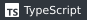
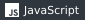
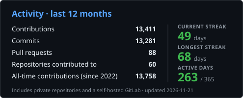
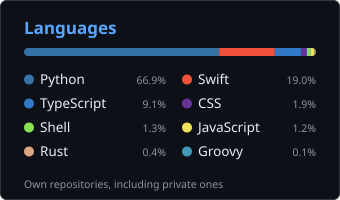

# Hi, I'm Jinsoo Kim

I build ontology engines and GraphRAG search, and agent harnesses that own judging, retries and memory. 
Then I ship them into banking, capital and retail customers' On-premise environments and measure them there.

  
  
  
  
  

## What I do

- **Ontology engine & search systems**: LLM-free ontology builds from documents, tables and databases, a PostgreSQL-native graph store, and one-shot GraphRAG retrieval with provenance.
- **Agent harness research & development**: a state-machine runtime that owns judging, retries, termination, memory and tool search, compiled into PyPI · npm · MCP packages.
- **XGEN maintenance & enterprise delivery**: porting the platform into air-gapped and On-premise customer environments, fixing what breaks there, and re-measuring under the same conditions.

## Capabilities

**Ontology & Retrieval** · [notes](https://blog.js-96.com/series/ontology-engineering/) 
Turning documents, CSV files and relational databases into an ontology, and answering from it with the evidence attached. 
<code>Ontology&nbsp;modeling</code> <code>Build&nbsp;pipelines</code> <code>Incremental&nbsp;sync</code> <code>PostgreSQL&nbsp;graph&nbsp;store</code> <code>GraphRAG&nbsp;fusion</code> <code>BM25F&nbsp;·&nbsp;PPR&nbsp;·&nbsp;MMR&nbsp;ranking</code> <code>Citation&nbsp;tracking</code>

**Agent Engineering** · [notes](https://blog.js-96.com/series/agent-harness/) 
Designing the runtime around the model: when to judge, retry and stop, what to remember, and which tools to show. 
<code>Agent&nbsp;runtime&nbsp;design</code> <code>Judge&nbsp;·&nbsp;retry&nbsp;·&nbsp;termination&nbsp;policy</code> <code>Agent&nbsp;memory</code> <code>Context&nbsp;engineering</code> <code>Progressive&nbsp;tool&nbsp;disclosure</code> <code>MCP&nbsp;servers</code> <code>HITL&nbsp;approval</code> <code>OAuth&nbsp;2.1&nbsp;PKCE</code>

**LLM Evals** · [notes](https://blog.js-96.com/series/evaluation/) 
Comparing models and agents under fixed conditions, with gold sets and judges that return the same verdict on reruns. 
<code>Fixed&nbsp;gold&nbsp;sets</code> <code>LLM-as-a-Judge</code> <code>Controlled&nbsp;comparisons</code> <code>Verdict&nbsp;determinism</code> <code>RAGAS</code>

**Enterprise Delivery** · [notes](https://blog.js-96.com/series/fde/) 
Building, deploying and maintaining XGEN inside customer networks, including responses to security vulnerability assessments for bank customers. 
<code>Air-gapped&nbsp;k3s&nbsp;·&nbsp;Helm</code> <code>PII&nbsp;masking</code> <code>Guardrails</code> <code>Audit&nbsp;trails</code> <code>Vulnerability&nbsp;assessment&nbsp;response</code> <code>vLLM&nbsp;serving</code> <code>Dependency&nbsp;·&nbsp;SBOM&nbsp;review</code> <code>Next.js&nbsp;·&nbsp;FastAPI</code>

**Data Science** 
Statistics, machine learning and deep learning research from my M.S. work, mainly forecasting and prediction. 
<code>Time-series&nbsp;forecasting</code> <code>DLinear&nbsp;·&nbsp;TimeMixer&nbsp;ensembles</code> <code>ML&nbsp;prediction</code> <code>Feature&nbsp;importance</code> <code>Clustering</code> <code>Text&nbsp;mining</code>

## Featured Projects

- **[xgen-omnifuse](https://github.com/jinsoo96/js-omnifuse)** &nbsp; 
  Backend-agnostic one-shot **GraphRAG** search that fuses vector, graph and HippoRAG expansion into a single synthesis. 
  Result: on a public financial-regulation benchmark, multi-hop strict answers went from **19 to 103 of 120** with no LLM in retrieval.

- **[xgen-ontology-build](https://github.com/jinsoo96/js-ontology-build)** &nbsp; 
  Documents, tables and DB rows into a provenance-tracked **ontology**, LLM-free by default. 
  Result: output diff **0** against the product pipeline on a **14,924-chunk** real corpus.

- **[xgen-harness](https://github.com/jinsoo96/xgen-harness-executor)** &nbsp; 
  10-stage state-machine **agent execution engine** that compiles canvas agents into PyPI · npm · MCP packages. 
  Result: under the same strict-citation judge, scores that split between 0 and full marks settled to **0.70 – 0.98**.

- **[Jermes](https://github.com/jinsoo96/jermes)** 
  Self-improving agent that promotes a procedure to a skill only when its gain reproduces on held-out runs. 
  Result: cumulative accuracy **44.2% → 88.9%** over 190 user questions.

- **[XGEN MAKER](https://github.com/jinsoo96/xgen-maker)** 
  Development-automation harness that lands natural-language requests on exact files and lines through a code ontology of 23 repos. 
  Result: **R@10 0.837** on 2,827 human-merged MRs.

- **[Agethos](https://github.com/jinsoo96/agethos)** &nbsp; 
  Personality, memory and emotion for LLM agents, with a draft · judge · repair persona compiler. 
  Result: persona compile fidelity **0.930**.

Also building: [missile-studio](https://github.com/jinsoo96/missile-studio) · [js-image-studio](https://github.com/jinsoo96/js-image-studio) · [ALTERLENS](https://github.com/jinsoo96/alterlens) · [comfy-workflow-mcp](https://github.com/PlateerLab/comfy-workflow-mcp) · [xgen-mcp-harness](https://github.com/PlateerLab/xgen-mcp-harness). The full list with release and commit history is on the [blog](https://blog.js-96.com/projects/).

## Tech Stack

**Languages** 

**AI & Data** 

**Backend & Frontend** 

**DevOps & Infra** 

## Background

**Experience**

- **Plateer Inc.** · AI Solution Research Institute, AI R&D Team · AI Engineer / FDE · 2026.01 – present 
  XGEN maintenance and feature development · AI agent research · ontology engine and search systems · On-premise delivery for bank, capital and retail customers (FDE) · security vulnerability assessment response for bank customers
- **Shaveron** · Freelance Developer (FDE) · 2025.01 – 2025.07 
  Dispatched to LG CNS Singlex Strategy/Operations Team · RAG chatbot prompts, retrieval and evaluation automation

**Education**

- M.S. Big Data Applied Science, Kyung Hee University · 2023.03 – 2025.02
- B.S. Statistics, Jeonbuk National University · 2016.03 – 2022.02

**Interests**: Agentic AI, Ontology & GraphRAG, LLM Evals, Multi-Agent Systems, Time-Series Forecasting

## Awards

- **2025** · Excellence Paper Award · Korea Society of Electronic Commerce & Smart Media Society
- **2024** · Excellence Paper Award · Korea Society of IT Services
- **2024** · Best Paper Award · Korea Intelligent Information Systems Society
- **2024** · Excellence Paper Award · Korean Academy of Management
- **2023** · Excellence Paper Award · Korea Society of Information Systems
- **2023** · Best Paper, Honorable Mention · KHU Big Data Graduate Student Conference
- **2023** · Grand Prize · Korea Knowledge Management Society Idea Competition

## Activity

<picture>
  <source media="(prefers-color-scheme: dark)" srcset="https://raw.githubusercontent.com/jinsoo96/jinsoo96/stats/stats-dark.svg" />
  <source media="(prefers-color-scheme: light)" srcset="https://raw.githubusercontent.com/jinsoo96/jinsoo96/stats/stats-light.svg" />
  
</picture>
<picture>
  <source media="(prefers-color-scheme: dark)" srcset="https://raw.githubusercontent.com/jinsoo96/jinsoo96/stats/langs-dark.svg" />
  <source media="(prefers-color-scheme: light)" srcset="https://raw.githubusercontent.com/jinsoo96/jinsoo96/stats/langs-light.svg" />
  
</picture>

<picture>
  <source media="(prefers-color-scheme: dark)" srcset="https://raw.githubusercontent.com/jinsoo96/jinsoo96/snake/github-contribution-grid-snake-dark.svg" />
  <source media="(prefers-color-scheme: light)" srcset="https://raw.githubusercontent.com/jinsoo96/jinsoo96/snake/github-contribution-grid-snake.svg" />
  
</picture>

